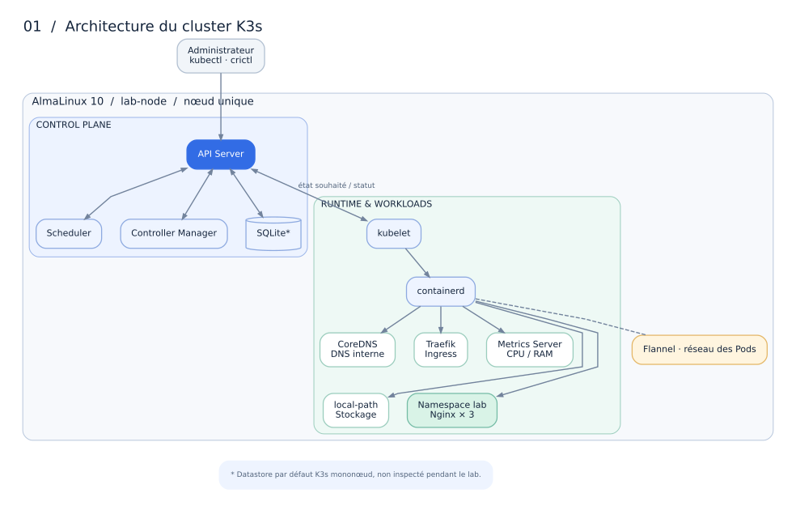
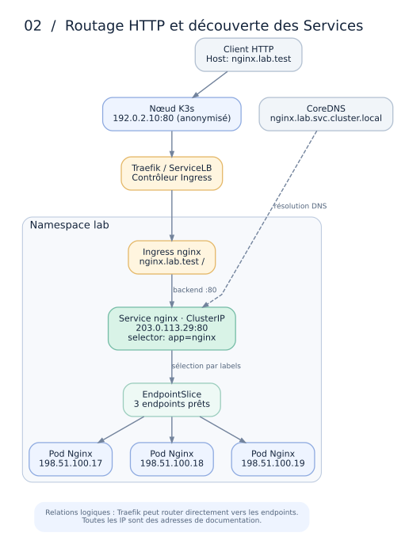
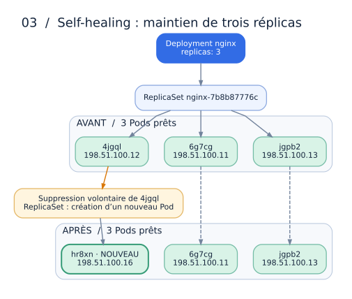
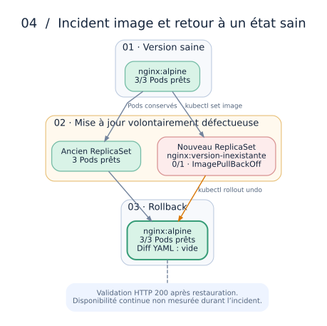

# Kubernetes & K3s — Infrastructure Lab

**Administration Linux · Kubernetes · Conteneurs · Networking · Troubleshooting**

> Projet personnel de mise en pratique : installation d'un cluster Kubernetes sur AlmaLinux, déploiement d'une application web répliquée, gestion déclarative et simulation d'incidents.

`AlmaLinux 10` · `K3s` · `containerd` · `kubectl` · `Nginx` · `Traefik` · `CoreDNS`

## Résultats du lab

| Déploiement | Redémarrages des Pods | Réseau | Incident simulé |
| :---: | :---: | :---: | :---: |
| **3/3** Pods prêts | **0** redémarrage final | **HTTP 200** | **Rollback réussi** |

Les résultats ci-dessus proviennent d'exercices exécutés sur une machine de test. Les [captures textuelles anonymisées](evidence/README.md) documentent les opérations et leurs résultats. Il ne s'agit pas d'un environnement de production ni d'une mesure de SLA.

## 1. Objectifs et périmètre

L'objectif est de comprendre le fonctionnement de Kubernetes en administrant un cluster réel, depuis son installation jusqu'à l'exposition d'une application et au diagnostic d'un déploiement défectueux.

- Installation et validation de K3s sur AlmaLinux 10, avec containerd.
- Administration du cluster avec `kubectl`, `crictl`, les namespaces et les contextes.
- Passage d'une approche impérative à une configuration déclarative en YAML.
- Scaling horizontal, self-healing, rolling update et rollback.
- Mise en place de requests/limits et de sondes de santé.
- Réseau interne, découverte DNS, Service ClusterIP et exposition HTTP via Traefik.
- Diagnostic à partir des événements, des logs, des EndpointSlices et des métriques.

## 2. Architecture



Le lab utilise un cluster **mononœud** : le control plane et les workloads partagent le même hôte. K3s fournit les composants nécessaires, dont Flannel, CoreDNS, Traefik, Metrics Server et le provisionneur `local-path`. SQLite est le datastore par défaut dans ce type d'installation K3s, non inspecté directement pendant les TP.

| Composant | Rôle |
| --- | --- |
| API Server | Point d'entrée de l'API Kubernetes |
| Scheduler / Controller Manager | Placement et réconciliation des ressources |
| kubelet / containerd | Exécution et supervision des conteneurs sur le nœud |
| Flannel / CoreDNS | Réseau des Pods et résolution DNS |
| Traefik / ServiceLB | Routage HTTP et exposition du contrôleur sur le nœud |
| Metrics Server | Métriques CPU/RAM utilisées par `kubectl top` |
| Local Path Provisioner | Stockage local dynamique (installé, pas encore testé) |

### Chemin logique d'une requête HTTP



La règle Ingress associe le nom de test `nginx.lab.test` au Service `nginx`. Ce dernier sélectionne les Pods avec le label `app: nginx`. Traefik peut acheminer directement les requêtes vers les endpoints du Service ; le schéma représente les relations logiques, pas nécessairement chaque saut réseau.

## 3. Travaux pratiques réalisés

| TP | Manipulations | Résultat observé |
| --- | --- | --- |
| 01 — Pod autonome | `run`, `describe`, `exec`, `logs`, JSONPath, port-forward | Page Nginx accessible ; espace utilisateur Alpine, noyau de l'hôte partagé |
| 02 — Deployment | ReplicaSet, scaling 3 → 5 → 3, suppression d'un Pod | Nouveau Pod créé automatiquement, nouvelle IP |
| 03 — Service | ClusterIP, labels, EndpointSlices, requête HTTP | Trois endpoints et page Nginx accessible |
| 04 — YAML | `diff`, dry-run serveur, `apply`, probes, requests/limits | Nouveau ReplicaSet, rollout réussi, 3 Pods prêts |
| 05 — Incident | Image inexistante, événements, `describe`, rollback | `ErrImagePull` / `ImagePullBackOff` puis retour à 3 Pods prêts |
| 06 — DNS / Ingress | BusyBox, CoreDNS, FQDN, Traefik, `curl --resolve` | Résolution DNS fonctionnelle et HTTP 200 |

### Self-healing : réconciliation de l'état désiré



Le ReplicaSet maintient trois réplicas. Après suppression d'un Pod, un nouveau Pod est créé avec une identité réseau différente. Le Service retrouve les endpoints à partir de leurs labels et de leur disponibilité.

### Rolling update et rollback



Une image volontairement inexistante a provoqué `ErrImagePull`, puis `ImagePullBackOff`. Les trois anciens Pods sont restés prêts dans les observations ; un nouveau Pod était en erreur. Le rollback a rétabli le Deployment et `kubectl diff -f deployment.yaml` n'a affiché aucune différence.

```text
NAME    READY   UP-TO-DATE   AVAILABLE
nginx   3/3     3            3

HTTP/1.1 200 OK
```

Extrait condensé de la validation finale. Voir [TP 05 et 06](evidence/02-declarative-network.txt) pour le contexte. Aucune mesure continue du trafic n'a été réalisée pendant l'incident : l'absence d'interruption n'est donc pas revendiquée.

## 4. Configuration déclarative

| Paramètre | Valeur par conteneur |
| --- | --- |
| Image | `nginx:alpine` |
| Réplicas | 3 (au niveau Deployment) |
| CPU request / limit | 50m / 200m |
| RAM request / limit | 32Mi / 128Mi |
| Readiness | HTTP GET `/`, toutes les 5 s |
| Liveness | HTTP GET `/`, délai initial 5 s, période 10 s |
| Service | ClusterIP, TCP 80 → 80 |
| Ingress | Traefik, `nginx.lab.test` |

Les requests servent notamment au placement des Pods ; les limits encadrent leur consommation. Les sondes de readiness déterminent si un Pod est prêt à recevoir du trafic, tandis que la liveness peut déclencher un redémarrage du conteneur.

## 5. Reproduire le lab

Prérequis : un cluster K3s de test fonctionnel avec Traefik, `kubectl` configuré, une connexion au registre d'images et des ressources suffisantes. Les étapes d'installation et les points de vigilance sont dans [le guide du lab](docs/setup.md).

Depuis la racine du dépôt :

```bash
kubectl apply -f manifests/namespace.yaml
kubectl apply --dry-run=server -f manifests/nginx/
kubectl apply -f manifests/nginx/
kubectl -n lab rollout status deployment/nginx --timeout=120s
kubectl -n lab get deploy,rs,pods,svc,ingress -o wide
```

Pour tester le routage local, remplacer l'adresse de documentation par celle du nœud accessible :

```bash
NODE_IP=192.0.2.10 # Adresse fictive à remplacer
curl --resolve "nginx.lab.test:80:${NODE_IP}" http://nginx.lab.test/
```

Autre possibilité, sans exposition sur le réseau :

```bash
kubectl -n lab port-forward svc/nginx 8080:80
# Dans un second terminal : curl http://127.0.0.1:8080/
```

Pour reproduire le scaling, le self-healing et l'incident d'image, voir [les exercices et le runbook](docs/runbook.md).

## 6. Organisation du dépôt

```text
.
├── README.md
├── .gitignore
├── manifests/
│   ├── namespace.yaml
│   └── nginx/
│       ├── deployment.yaml
│       ├── service.yaml
│       └── ingress.yaml
├── docs/
│   ├── setup.md
│   ├── runbook.md
│   └── diagrams/         # SVG et sources Graphviz DOT
└── evidence/
    ├── README.md
    ├── 01-pods-services.txt
    └── 02-declarative-network.txt
```

## 7. Limites et prochaines étapes

Ce lab valide des opérations de base sur un nœud unique ; trois Pods sur un même hôte ne constituent pas une haute disponibilité d'infrastructure. Le tag `nginx:alpine` a été conservé pour refléter les TP, mais une image versionnée ou épinglée par digest est préférable pour un déploiement reproductible. L'Ingress du lab utilise HTTP sans TLS.

- [x] Installation, Pods, Deployments, Services et namespaces
- [x] YAML, ressources, probes, rolling update et rollback
- [x] DNS interne, Traefik, Ingress et métriques de base
- [ ] PV/PVC, PostgreSQL et StatefulSets
- [ ] ConfigMaps, Secrets, RBAC et NetworkPolicies
- [ ] Helm côté administrateur, Prometheus et Grafana
- [ ] Cluster multinœud, haute disponibilité, sauvegardes et GitOps

## 8. Confidentialité et provenance

Les manifests sont reconstruits à partir des exercices et des sorties `kubectl diff` / `describe`. Le manifest Namespace est ajouté pour faciliter la reproduction. Les preuves sont des extraits de terminal sélectionnés et anonymisés, non des captures brutes ni des attestations indépendantes. Les IP internes et le nom d'hôte ont été remplacés, les identifiants de runtime et autres détails superflus ont été écartés. Aucun kubeconfig, certificat, jeton ou secret n'est fourni. Les noms génériques des objets et les suffixes de Pods/ReplicaSets sont conservés pour suivre les événements.

Documentation de référence : [Kubernetes](https://kubernetes.io/docs/) · [K3s](https://docs.k3s.io/) · [Traefik](https://doc.traefik.io/traefik/).
